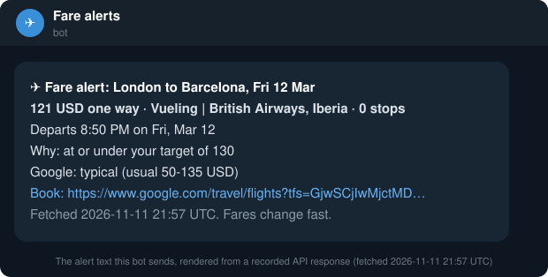

# flight-price-alert-bot

A small Telegram (or Discord) bot that watches flight routes and messages you when a fare drops.
It checks live Google Flights fares on a schedule and alerts when the cheapest fare is under your
target price, under Google's own usual range for the route, or rated `low` by Google. It never pings
you twice for the same price.

One Python file, standard library only. Run it with Docker, on any small server, or for free on
GitHub Actions.



## How it decides

For every watch in `watches.json`, each check makes **one request** to the
[Google Flights Live API](https://rapidapi.com/mtnrabi/api/google-flights-live-api) (one-way, or
round trip when you give a `return_date`; a round trip is priced as one request with both legs and one
booking link). It takes the cheapest itinerary and sends an alert if:

- the price is at or under your `target_price`, or
- the price is under `price_insights_low`, the bottom of Google's usual range for that route and period, or
- Google rates the fare `low` (`price_range_in_relation_to_other_periods`),

**and** it is cheaper than the last fare it told you about (kept in `state.json`). When the deal
goes away, it forgets it, so the next drop alerts again. A search that did not complete is logged
and retried on the next check; it is never reported as "no flights".

## Real example

With the two watches in [`watches.example.json`](watches.example.json), on fares fetched
**2026-11-11 21:57 UTC**:

```text
$ python alert_bot.py --once --dry-run --replay recorded
Watching 2 route(s); 2 request(s) per check
[London to Barcelona, Fri 12 Mar] cheapest 121 USD, Google: typical
---- would send ----
✈️ Fare alert: London to Barcelona, Fri 12 Mar
121 USD one way · Vueling | British Airways, Iberia · 0 stops
Departs 8:50 PM on Fri, Mar 12
Why: at or under your target of 130
Google: typical (usual 50-135 USD)
Book: https://www.google.com/travel/flights?tfs=GjwSCjIwMjctMDMtMTIiIAoDTEhSEgoyMDI3LTAzLTEyGgNCQ04qAlZZMgQ3NjQzagUSA0xIUnIFEgNCQ05CAQFIAZgBAg&curr=usd
Fetched 2026-11-11 21:57 UTC. Fares change fast.

[New York to Lisbon, 1-8 Feb] cheapest 628 USD, Google: typical
```

London to Barcelona was under its $130 target, so it alerts. New York to Lisbon was $628 against a
$600 target and Google called it `typical`, so it stays quiet. Those responses are saved in
[`recorded/`](recorded), so `--replay recorded` works without a key.

## Quick start (2 minutes)

1. **API key.** Open the [Google Flights Live API on RapidAPI](https://rapidapi.com/mtnrabi/api/google-flights-live-api),
   sign up and subscribe to the free **BASIC** plan (a small monthly request quota, no card).
2. **Telegram bot.** Message [@BotFather](https://t.me/BotFather), send `/newbot`, copy the token.
   Send your new bot any message, then open `https://api.telegram.org/bot<TOKEN>/getUpdates` and copy
   `chat.id`. (Discord instead: Channel settings > Integrations > Webhooks > New webhook > copy URL.)
3. **Configure and run.**

   ```bash
   git clone https://github.com/mtnrabi/flight-price-alert-bot
   cd flight-price-alert-bot
   cp .env.example .env                 # fill in RAPIDAPI_KEY and TELEGRAM_* (or DISCORD_WEBHOOK_URL)
   cp watches.example.json watches.json # your routes, dates and target prices
   python alert_bot.py --once --dry-run # check once, print instead of sending
   python alert_bot.py                  # keep watching (every CHECK_EVERY_HOURS, default 6)
   ```

## watches.json

```json
[
  { "name": "London to Barcelona, Fri 12 Mar", "from": "LHR", "to": "BCN",
    "departure_date": "2027-03-12", "target_price": 130 },
  { "name": "New York to Lisbon, 1-8 Feb", "from": "JFK", "to": "LIS",
    "departure_date": "2027-02-01", "return_date": "2027-02-08", "target_price": 600, "max_stops": 0 }
]
```

| Field | Meaning |
|---|---|
| `from`, `to` | IATA airport codes (required) |
| `departure_date` | YYYY-MM-DD (required) |
| `return_date` | set it for a round trip |
| `target_price` | alert at or under this total |
| `currency` | `usd` (default), `eur`, `gbp`, ... |
| `max_stops` | max stops per leg; `0` = nonstop |
| `passengers` | one code per traveller: 1 adult, 2 child, 3 infant on lap, 4 infant in seat |
| `alert_below_google_range` | default `true` |
| `alert_on_low_verdict` | default `true` |

## How many requests

One per watch per check. Three watches checked every 6 hours is 12 requests a day, about 360 a month.
The free BASIC plan covers a light watch (its monthly quota is on the pricing tab); for more, **PRO is
$10 a month for 2,500 requests**. Set `CHECK_EVERY_HOURS` to match your plan.

## Deploy

**Docker** (any VPS, a Raspberry Pi, a home server):

```bash
mkdir -p data && cp watches.json data/
docker compose up -d --build
```

**GitHub Actions** (free, no server): copy
[`examples/github-actions/flight-alerts.yml`](examples/github-actions/flight-alerts.yml) to
`.github/workflows/` in your fork and add `RAPIDAPI_KEY`, `TELEGRAM_BOT_TOKEN`, `TELEGRAM_CHAT_ID` as
repository secrets. It runs `--once` every 6 hours and keeps `state.json` in the Actions cache.

**Cron:** `17 */6 * * * cd /path/to/flight-price-alert-bot && python3 alert_bot.py --once`

## The request it sends

```bash
curl -X POST https://google-flights-live-api.p.rapidapi.com/api/google_flights/oneway/v1 \
  -H "Content-Type: application/json" \
  -H "x-rapidapi-host: google-flights-live-api.p.rapidapi.com" \
  -H "x-rapidapi-key: $RAPIDAPI_KEY" \
  -d '{"from_airport":"LHR","to_airport":"BCN","departure_date":"2027-03-12","currency":"usd","limit":5,"sort_type":"Price"}'
```

Round trips go to `.../roundtrip/v1` with a `return_date`. Field reference:
[the API listing](https://rapidapi.com/mtnrabi/api/google-flights-live-api) and
[api.flightpowers.com/docs](https://api.flightpowers.com/docs). The script also sends `_fp_source` /
`_fp_tool` so FlightPowers can count requests from this example; the API removes them before the
search, and you can delete them from `ATTRIBUTION`.

## Tests

```bash
pip install pytest && pytest -q
```

They run on the recorded responses (no key, no network) and cover the alert rules, the no-repeat
logic, failed searches and the Telegram / Discord request shapes.

## Related

- [cheapest-week-to-fly](https://github.com/mtnrabi/cheapest-week-to-fly): scan a date range and rank
  the cheapest round trips.
- [n8n-flight-fare-watch](https://github.com/mtnrabi/n8n-flight-fare-watch): a daily fare watch as an n8n
  workflow or a GitHub Action, with email or Slack.
- [FlightPowers](https://flightpowers.com): the API behind these examples, also as an MCP server for
  Claude, Cursor and ChatGPT.

Not affiliated with Google, Telegram or Discord. MIT licensed.
